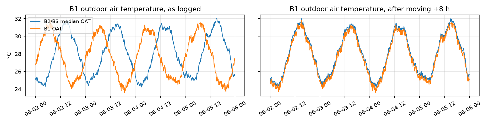
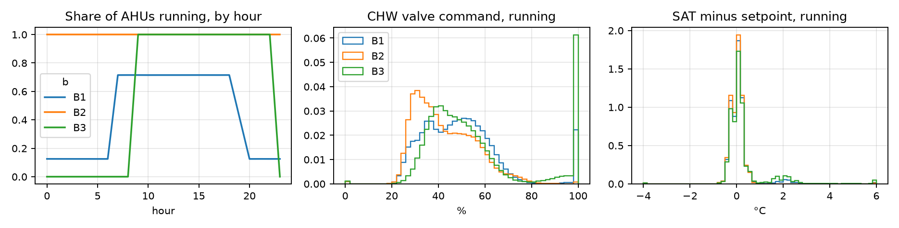
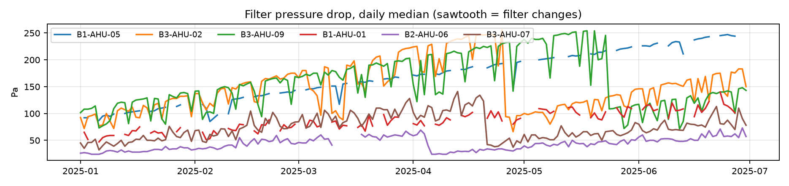
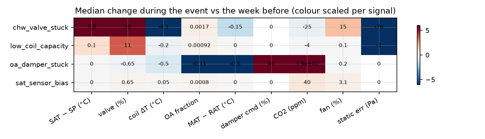

# Question 1: Exploratory data analysis and data quality

## 1.1 Approach

I worked in five steps. Every check became a function in `code/src/ahu_fdd/clean.py`, so the same rule runs on the test period and later in production. Each step is a section of `notebooks/ahu_fault_detection.ipynb` (sections 1 to 6).

1. **Structure and coverage.** Rows per AHU per day, duplicates, gaps, missing values per column and per building.
2. **Data quality.** Plot every signal per AHU over time, then compare it with its physical range, with its neighbours and with the outdoor air temperature (OAT). All three buildings share the same weather, so OAT works as a reference clock.
3. **Patterns.** Compare operating schedules, valve and setpoint behaviour across buildings and units.
4. **Physics vs labels.** For each fault type, write down which signals should move and why, then measure what moved in the labelled events.
5. **Unlabelled cases.** Look for periods that look like faults but have no work order, and for labelled events that are hard to see.

## 1.2 Data quality: what I found and what I did

| Problem | Where | How I found it | Fix |
|---|---|---|---|
| Logger clock 8 h off for a week | B1, 1 Jun 16:00 to 8 Jun 16:00 (32,153 rows) | Two different readings per timestamp on 1 Jun, then an 8-hour hole on 8 Jun. B1's OAT was out of step with B2/B3: mean gap 3.6 °C as logged, 0.3 °C after shifting by +8 h. The logger was writing UTC. | Shift those rows +8 h |
| Duplicate export | B3, 14 Feb (3,439 rows) | Identical rows twice | Drop one copy |
| Fan power in W, not kW | B3-AHU-04, 1 to 21 Apr (6,023 rows) | Power up to 1,000× rated motor power, including 40 "kW" standby readings with the fan off | Divide whole days by 1,000 |
| CO2 stuck at 0 or 5,000 ppm | B2-AHU-03, 20 Jan to 27 Feb (781 rows) | Values at the sensor's range limits | Set to missing |
| Frozen supply-air sensor (SAT) at 13.1 °C | B2-AHU-08, 21 to 29 Jul, test period (2,587 rows) | Unchanged reading for days while the valve moves | Set to missing and flag. The model gives no alert while a key sensor is flagged. |
| Frozen return-air sensor (RAT) at 23.4 °C | B1-AHU-07, 5 to 26 May (2,239 rows) | Same check | Same fix |
| 8-day outage | B2, 10 Mar 05:55 to 18 Mar 14:00 | Missing rows | Left as a gap. Rolling windows do not reach across it. |
| Missing by design | CO2 is missing in B3; airflow exists only in B2 | Missing values per building | Kept missing. The model treats a missing sensor as missing, not as zero. |

Other checks came back clean:
- No other sensor sits at its range limits.
- Setpoints are constant per AHU.
- Fan status agrees with fan speed and power.
- In the test period the only missing values are CO2 and supply airflow where no sensor exists (30% and 70% of rows), and the DQ mask removes B2-AHU-08's frozen SAT from 21 to 29 July. About 0.3% of its expected rows (2,245) are absent: short logging gaps, left as gaps.

**What I would ask the client to check:**
1. The B1 logger's time zone and NTP setting. If it can drift once, it can drift again.
2. The B3-AHU-04 power meter configuration (units in April).
3. The B2-AHU-03 CO2 sensor, the B2-AHU-08 SAT sensor and the B1-AHU-07 RAT sensor. Frozen sensors are a maintenance issue in their own right.
4. What happened in B2 on 10 to 18 March (BMS or network outage).
5. Three chronically saturated units, B1-AHU-05, B3-AHU-02 and B3-AHU-09 (see 1.3).
6. Filter replacement intervals, B1-AHU-05 in particular.
7. B1-AHU-11, 22 April to 5 May: a probable outdoor-air damper fault with no work order (see 1.5).

## 1.3 Patterns across buildings and units

**Schedules.**
- B2 (hospital) runs non-stop.
- B3 (mall) runs 09:00 to 23:00 every day.
- B1 (office) runs on weekdays only (the curve averages in weekends, hence 71.5%). Two of its 16 units run 24/7, which gives the 12% floor at night.

Start-up and shut-down rows are transient, so the model scores only steady running rows (fan on for at least 30 minutes).

**Valve and setpoint.** For the middle half of running time the chilled-water (CHW) valve sits between about 32% and 60% (25th to 75th percentile across the three buildings) and SAT holds setpoint within ±0.3 °C. Two exceptions:
- B3 and B1 show a spike at 100% valve together with a second hump at SAT +2 °C.
- This comes almost entirely from three units: **B1-AHU-05, B3-AHU-02 and B3-AHU-09**. Their valve is above 95% for 73 to 84% of running time and the fan is near 100%, yet SAT still sits 1.5 to 1.9 °C above setpoint, outside any labelled event.
- These units are undersized or chronically degraded (fouled coil or low CHW flow; the filter changes rule out filter loss). On them, "low coil capacity" cannot show up as more valve opening. That is why they cause half of the model's errors (Q2).

**Filters.** Filter pressure drop follows a sawtooth: a slow rise, then a step down at each filter change (B3-AHU-07 from about 135 to 40 Pa in late April, B2-AHU-06 from about 65 to 25 Pa in early April). B1-AHU-05 climbs from about 90 to 245 Pa from January to June and is changed only on 30 June. All three saturated units get a filter change, and none of them stops saturating (valve above 95% for 84%, 72% and 77% of running time before, 85%, 75% and 80% after), so the filter is not the cause. Filter loading is normal ageing, not a labelled fault, so the normal-behaviour models take filter pressure drop as an input instead of flagging it.

## 1.4 Fault physics vs the labels

For each labelled event, the figure shows the median of each signal during the event minus the same AHU's median over the week before. These are steady rows only, with the median taken across events of the same type.

| Fault | Expected (physics) | What the labels show |
|---|---|---|
| **Stuck CHW valve** | Stuck closed: less cooling, so SAT rises above setpoint. The controller keeps asking for more, so the valve command rises while coil ΔT falls. The fan speeds up to meet zone load. Stuck open: the reverse (SAT below setpoint, command falls). | SAT error +5.8 °C, valve command +20%, coil ΔT −4.1 °C, fan +15%. Both directions appear, so the classifier needs the sign as well as the size of the change. **Agrees.** |
| **Low coil capacity** (fouling, low CHW flow) | Each % of valve opening does less cooling. The valve opens further to hold SAT. SAT stays on setpoint until the valve saturates, then drifts up. | Valve +11%, SAT error about 0. On the three saturated units, SAT rises instead. **Agrees, but subtle:** a slow drift that is easy to confuse with load. |
| **Stuck OA damper** (closed) | Less outdoor air, so mixed-air temperature (MAT) moves toward RAT, the outdoor-air fraction falls and CO2 climbs. On CO2-controlled units the damper command rises with no effect. | Outdoor-air fraction −0.11, MAT−RAT −0.6 °C, damper command +40%, CO2 +586 ppm. **Agrees.** In B3, with no CO2 sensor, only the small MAT shift remains. |
| **SAT sensor bias** (reads high or low) | The loop controls to the wrong value, so the measured SAT stays on setpoint while the real air is warmer or colder. The only traces are indirect: valve position and fan effort that no longer match the load, and slow comfort effects (CO2, zone load). | Fan +3%, valve +0.65%, CO2 +40 ppm: very small. **Hard to see by design.** It needs an independent temperature to confirm. |

## 1.5 Unlabelled and hard-to-see cases

- **B1-AHU-11, 22 April to 5 May: an unlabelled stuck damper.**
  - The outdoor-air fraction falls from 0.08 to 0.02 and CO2 climbs by about 650 ppm.
  - The damper command rises from 15% to 70% with no effect: the stuck-damper signature exactly, with no work order.
  - The model flags it (Q2), and it is one of only two "false alarms" out of fold. Labels come from work orders, so they are incomplete. A false-alarm count against them overstates the true false alarms.
- **The three saturated units look like permanent low coil capacity.** They are not labelled, and probably should be checked as one maintenance item each.
- **Labelled but hard to see:**
  - Sensor-bias events change almost nothing in the raw signals. The model still finds all 6, because the controller opens the valve and shifts the fan to chase a SAT reading that is off, and those residuals leave the normal band on 77% and 69% of fault rows. They are the slowest fault to detect (median 31 hours in sample).
  - Damper faults in B3 have no CO2 to confirm them.
  - Short events (under a day) leave little evidence once the analysis is restricted to steady running rows.
- **Labels have fuzzy edges.** Start and end come from work orders, so signals often begin to move before the labelled start. The model therefore does not train on rows within a day of an event as "normal" (Q2).
- **Test period (July to August):**
  - B2-AHU-08's frozen SAT is a data fault, not a coil fault. The DQ mask keeps it from raising an alarm.
  - Against their April to June baseline, a few units drift. B1-AHU-12 and B3-AHU-06 run fans about 6% slower, and B2-AHU-12 takes less outdoor air. The model raises sustained alarms on all three in the test predictions (sensor bias, sensor bias and damper respectively). They are worth a site check.
