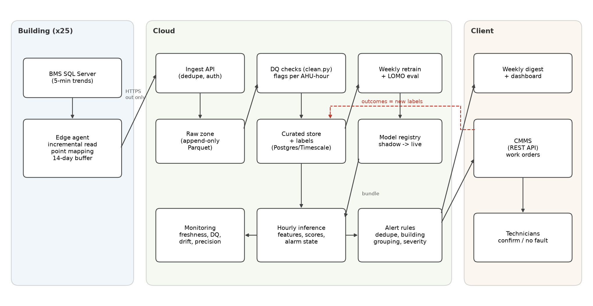

# Question 3: Production architecture

{style="max-height:none"}

## 3.1 Data path

**Edge (one small agent per building).** A Windows service reads new rows from the BMS SQL Server every 5 minutes, using the timestamp plus the row key as a watermark. It maps the site's point names to my standard schema with a per-building YAML file kept in Git, buffers compressed Parquet locally for 14 days, and pushes the files over outbound HTTPS to an ingest API, which drops duplicates by (ahu_id, timestamp, hash). The agent does no modelling, sends a heartbeat every 5 minutes and polls the API for config and updates, so I never need inbound access.

**Cloud storage.** Files land in object storage in two zones. The *raw* zone is append-only and never edited, so any result can be replayed. The *curated* zone is the output of this take-home's `clean.py`, run as data-quality (DQ) checks for clock shifts, duplicate exports, unit errors, out-of-range values, frozen sensors and gaps. Each check writes a DQ flag per AHU-hour instead of silently fixing data. Flags feed the model, which should hold fault alerts while a key sensor is flagged (a rule the take-home code does not have yet), and a DQ ticket queue, since a frozen sensor is worth a work order too.

**Scale.** At 600 AHUs the fleet logs about 173k rows a day, and the 2,000-AHU target about 576k, a few hundred MB of Parquet. One Postgres/TimescaleDB instance (or DuckDB over Parquet) and an hourly batch job on one machine handle that in minutes, so I need no Spark or streaming.

## 3.2 Models

**Training (weekly, or on demand).** The job retrains the normal-behaviour models and the classifier on all curated history, treating rows without an open work order as no-fault, and reruns the notebook's leave-one-month-out evaluation. The output is one versioned bundle (model files, thresholds, feature list, code commit, evaluation report) in a model registry (MLflow or a versioned bucket). The Q2 notebook already writes one (`outputs/model/bundle.json`).

**Promotion.** False alarms are rare (0.0125 per AHU-month in Q2), so a one-week shadow run on 40 AHUs (about 9 AHU-months) cannot tell two bundles apart. Promotion therefore has two gates. In a *labelled replay* the new bundle (challenger) and the live one (champion) score all labelled history out of fold, and the challenger must find and type at least as many events, compared event by event with McNemar's test, with no more false alarms. A fleet-wide *shadow run* then bounds the false-alarm rate. No unconfirmed alarm in 30 AHU-months puts the 95% upper bound at 0.1 per AHU-month, which takes a little over three weeks on 40 AHUs and under two days on 600. Rollback re-points to the previous, never-edited bundle in minutes.

**Inference (hourly).** Each hour the job scores the last 24 h of each AHU and runs the stateful alarm machine, the same causal code validated offline. Hourly is enough. The median delay of about 10 hours comes from the 3 to 12 h evidence windows, not from how often I score, and safety-critical conditions (a fan trip, a fire damper) stay with the BMS's own alarms.

**Technology choices.** Python, LightGBM and Parquet, because the model is built with them and one engineer can run them. Postgres/TimescaleDB for curated data and alarm state, because SQL suits the facility engineers. Prefect (or cron on a managed container) runs the jobs on a managed cloud (Azure suits Windows and SQL Server sites). Nothing here needs Kafka, Spark or a GPU.

## 3.3 From score to work order

Alarms reach the CMMS only through a small rules layer.

1. **Deduplicate.** One open ticket per AHU and fault, and a repeat alarm updates it.
2. **Group by building.** When more than about 30% of a building's AHUs show the same signature at once (SAT high with valves at 100%), it is probably a plant problem such as warm chilled water, so one plant ticket replaces the AHU tickets.
3. **Severity and route.** Faults that waste energy or hurt comfort now (stuck valve, stuck damper on a CO2-controlled unit) become work orders, and slow ones (coil capacity, sensor bias) go into a weekly digest. Each ticket carries the evidence plots and a "what to check" note (*stroke the valve 0 to 100% and watch SAT*).
4. **CMMS REST API.** When a technician closes a ticket, the outcome (*confirmed / no fault found / other cause*) is read back. **These outcomes become new labels** and feed the precision metric.

## 3.4 Monitoring

| What | How | Alert when |
|---|---|---|
| Data freshness | heartbeat and last row per building | no data for 30 min |
| Data quality | DQ flags per AHU per day | new flag type, or > 5% of rows flagged |
| Input drift | PSI of the 10 most important features and of weather and chilled-water temperature, live month vs training window | PSI above 0.2 (watch) or 0.3 (act), read against the largest month-to-month PSI seen in training |
| Alert volume | alerts per AHU per month, per building | 2x the validation rate |
| Outcome | precision from CMMS outcomes, time to close | precision below 60% over 4 weeks |

**Retraining triggers.** Besides the weekly job, a retrain starts early when a key feature crosses PSI 0.3 in more than one building, when precision falls more than 5 points below its previous-quarter level for 4 weeks, when 10 new confirmed labels arrive, or when a building changes its schedules or setpoints. Every retrained bundle still has to pass both gates. **In the first month after go-live** an engineer reviews every alert before it reaches the CMMS, and every no-fault-found outcome with the technician within 48 h. A rising alert rate with no rise in confirmed faults usually means the building changed, so that building is re-baselined instead of retuning the model for everyone.

## 3.5 Onboarding a new building (alerts in under a week when the BMS keeps history)

1. **Day 1.** Install the agent and fill the point-mapping template, which the agent checks against the BMS point list.
2. **Days 1-2.** Backfill the history the BMS keeps (usually 3 to 12 months) and review its DQ checks with the site's engineer. This is where wrong clocks and wrong units turn up.
3. **Days 2-5.** Score in shadow mode. In Q2 a new AHU with no history of its own raised 0.75 false alarms per AHU-month (60× the shipped 0.0125), and refitting the normal models on 14 healthy days brought that to 0.036. Those days can come from the backfill, so the refit runs on day 2. Q2 only tested new units inside known buildings, though. A new building also brings a building code the classifier has never seen (its trees treat it like B3) and its own plant and schedules, so this shadow run is the first real test of transfer, and go-live waits for it.
4. **Go-live** on day 5 (two weeks later without a backfill), with an engineer reviewing every alert. More than one unconfirmed alert in the first two weeks sends the building back to shadow mode for a mapping check. Two weeks on 12 to 16 units is only 6 to 8 AHU-months, enough to catch a bad mapping but not to prove 0.1 false alarms per AHU-month.
5. **Leaving "new unit" status.** A refit unit is still about 3× noisier than a known one (0.036 against 0.0125). The normal models are refit again at 30 and 60 days, and engineer review ends once the building's own rate over the last month is at or below 0.1 per AHU-month with at least 70% of alerts confirmed. I measured only the 14-day point, so how fast the rate falls is an assumption the pilot has to check.

**Missing sensors.** Losing CO2 or airflow barely changes detection in Q2 (28 found and 22 typed without CO2, 27 and 21 without airflow too). The mixed-air temperature matters more. Without it false alarms rise from 2 to 8 (0.033 per AHU-month), both counted with thresholds tuned on the scored months as in the Q2 table, because it carries the damper evidence, so a building lacking it keeps engineer review on damper alerts. Both results are upper bounds, since the normal models still saw these sensors.
